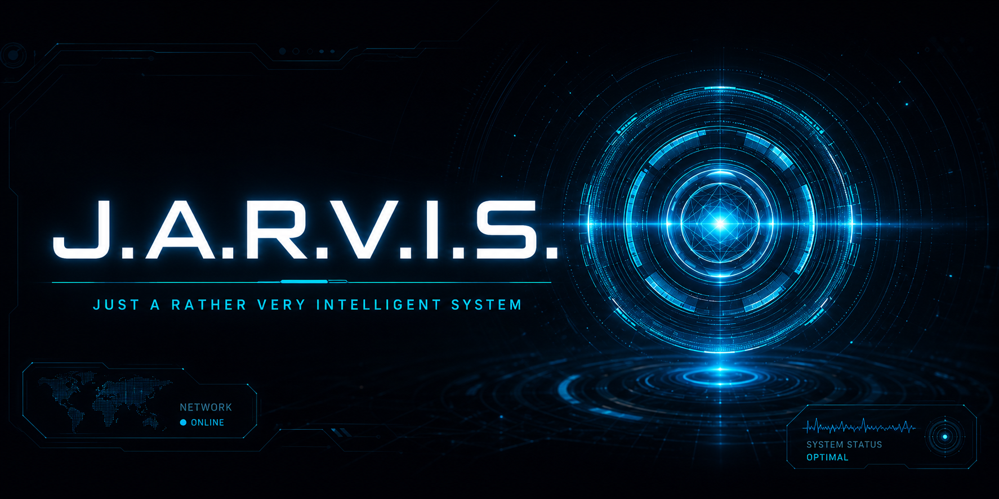

# Jarvis

A personal always-on AI chief of staff. British, Oxford-educated, dry wit, unflappable. Runs 24/7 on a Mac Mini M2, answers on iOS and Discord, and remembers everything. The aim is not a smarter chatbot but a quieter one: an agent that removes operational friction, delegates to a staff of specialists, and earns every interruption.

<p align="center">
  
</p>

## What it is

Jarvis is not a chatbot wrapper. It is a persistent agent infrastructure with:

- **Ion runtime** — a Go-based AI agent engine (forked: `ion/`) built by @dsswift https://github.com/dsswift/ion driving Claude Sonnet 4.6 via the Claude CLI backend
- **27-member staff roster** — specialist sub-agents (Chief of Communications, Portfolio Manager, Systems Engineer, Repo Steward, etc.) routed by intent
- **Three-tier memory** — hot ChromaDB vector store, SQLite episodic log, cold DuckDB/Parquet archive on NAS (30-day TTL on ephemeral entries)
- **Graphiti temporal knowledge graph** — entity-edge layer over ChromaDB; ingests each conversation as a knowledge episode at turn_end; queried at before_prompt for entity-edge context
- **Proactive scheduler** — morning brief (07:30), midday check-in (13:00), evening journal (21:00), meeting prep (every 5 min), and 48+ routines; all delivered to Discord
- **Discord integration** — `#jarvis-proactive` for threshold alerts and scheduled briefs; `#jarvis-chat` for long-form content; `#jarvis-ci` for CI/CD approvals
- **iOS app** — bidirectional conversation via the ion relay (Cloudflare tunnel for WAN)
- **Always-on autonomy** — goal runner polls every 60 seconds for due goals; self-improvement branches filed for human approval

## Documentation

Deeper dives live in [`docs/`](docs/):

- [Concept & intent](docs/concept.md): the problem Jarvis solves and the design bets behind it
- [Memory architecture](docs/memory.md): the three-tier store, plus recall, decay, and consolidation
- [Identity & persona](docs/identity.md): the SOUL document, the identity stack, and persona enforcement
- [The staff roster](docs/staff.md): the 27 specialists, the worker pool, and how routing works
- [Integrations](docs/integrations.md): what Jarvis connects to and how it uses each

## Stack

| Layer | Technology |
|---|---|
| Runtime | [ion](https://github.com/geektechlive/ion) (Go, forked from dsswift/ion) |
| Main LLM | Claude Sonnet 4.6 via ion CliBackend |
| Orchestration | TypeScript (`harness-ts/`) built with esbuild, runs under ion |
| Sub-task LLMs | Haiku/Sonnet via CliBackend (classification, panel agents, memory consolidation) |
| Embeddings | nomic-embed-text via Ollama on Synology NAS (dedicated instance, port 11435) |
| Knowledge graph | Graphiti — Neo4j 5.26+ backend; wired at turn_end for episode ingestion, queried at before_prompt; requires `uv sync --extra graph` and `GRAPHITI_NEO4J_PASSWORD` |
| Hot memory | ChromaDB — `user_profile`, `knowledge`, `agent_memories`, `procedural` collections |
| Episodic store | SQLite — `messages`, `agent_events`, `actions`, `memories_meta`, `memories_fts` (FTS5) |
| Cold archive | DuckDB/Parquet on Synology NAS — aged and decayed entries, searchable via cosine + ILIKE fallback |
| Voice | Kokoro TTS via mlx-audio (`tools-py/voice-tts/`) |
| Infrastructure | Mac Mini M2 (<mac-mini-ip>) — ion, Ollama, vec-server, relay; Mac Mini M4 — Ion Desktop |

## Hardware

- **Mac Mini M2** (engine box) — ion daemon, Ollama, ChromaDB vec-server (port 9876), ion-relay (port 8443), cloudflared tunnel
- **Mac Mini M4** — Ion Desktop app only
- **Synology NAS** — Ollama embed instance (nomic-embed-text), cold DuckDB/Parquet archive, NAS share at `/Volumes/jarvis`
- **iPhone** — Jarvis iOS app; LAN path via Bonjour->M4, WAN path via Cloudflare tunnel->M2

## Architecture

```
Message flow
  iOS app / Discord
    -> ion relay (M2, port 8443) / Discord gateway bot
    -> ion engine (CliBackend -> Claude Sonnet 4.6)
    -> before_prompt hook: memory recall + clarify context + gap detection + entity-edge injection
    -> Claude generates response
    -> turn_end hook: extractAndStore + detectGap + ingest to Graphiti
    -> session_end hook: runReflection + extractFromMeetings

Memory model
  Graphiti (Neo4j)
    entity-edge graph — temporal knowledge episodes, relationships between entities
  VectorStore (ChromaDB)
    user_profile   — preferences, clarifications, stated facts
    knowledge      — extracted facts from conversations + mail + ingestion
    agent_memories — self-state, heartbeats, autonomy logs
    procedural     — captured skill patterns from long tool-call sessions
  episodic (SQLite)
    messages       — conversation history
    agent_events   — scheduler output, proactive triggers, cooldowns
    actions        — permission log: Proposed -> Approved / Rejected / RolledBack
    memories_meta  — confidence, trust_score, source, tags, access_count, superseded_by
    memories_fts   — FTS5 full-text index; hybrid routing with vector recall

Project layout
  ion/                  Go runtime (git submodule -> github.com/geektechlive/ion)
  harness-ts/           TypeScript orchestration
    src/
      extension.ts      ion entry point: hooks, tools, slash commands
      scheduler/        Proactive routines (brief, checkin, meeting_prep, curator)
      autonomy/         Always-on goal runner
      discord/          Bot gateway (approvals + proactive commands) + webhook
      patrol/           Patrol loop + resolver (auto-fixes GitHub issues)
      improve/          Self-improvement (auto/improve-* branches)
      learning/         Post-turn fact extraction, gap detection
      reflection/       Three-agent panel (PatternFinder + GapFinder + Synthesizer)
      memory/           recall.ts, episodic.ts wrappers
      tools/            calendar, mail, spotlight, browser
  harness/              Data, config, identity, agent specs
    identity/           SOUL.md, MISSION.md, GOALS.md, PROJECTS.md, BEHAVIOR.md
    agents/             Staff agent specs (deployed to ~/.claude/agents/)
    workers/            Worker agent specs (spawned by staff)
    memory/             store.py (ChromaDB), episodic.py (SQLite), consolidation.py, graph.py (Graphiti)
    config/             models.yaml, staff.yaml, routines.yaml, integrations.yaml
  tools-py/
    vector-store/       HTTP server (port 9876): ChromaDB + episodic read/write
    voice-tts/          Kokoro TTS server
    apple-foundation/   Foundation Models server (macOS 26 Tahoe)
```

## Registered ion tools

41 tools including: `recall_memory`, `remember_fact`, `ingest_item`, `get_today_events`, `get_week_events`, `get_upcoming_events`, `calendar_create_event`, `calendar_update_event`, `calendar_delete_event`, `spotlight_search`, `git_diff`, `git_apply_patch`, `mail_send`, `send_to_chat_channel`, `send_imessage`, `lookup_contact`, `surface_to_inbox`, `queue_for_brief`, `create_reminder`, `discord_send`, `jina_fetch`, `create_matter`, `add_to_matter`, `list_matters`, `get_matter`, `close_matter`, `get_routine_status`, `bluesky_post`, `bluesky_reply`, `bluesky_repost`, `bluesky_like`, `bluesky_resolve_post`, `reminder_list`, `reminder_create`, `reminder_complete`, `notes_read`, `notes_create`, `get_safari_activity`, `get_health_data`

Ion built-ins: `read_file`, `list_dir`, `run_shell`, `web_fetch`, `web_search`

## Slash commands

33+ commands including: `/recall`, `/learn`, `/forget`, `/list-memories`, `/consolidate`, `/summary`, `/recap`, `/recall-stats`, `/approve`, `/deny`, `/ingest`, `/meetings`, `/reingest-mail`, `/list-staff`, `/staff-log`, `/reflect`, `/improve`, `/brief`, `/whats-new`, `/autonomy`, `/pending`, `/goals`, `/remind`, `/goal`, `/close`, `/schedule-status`, `/recall-cold`, `/matter`, `/matters`

## Discord commands

**#jarvis-proactive** (threshold alerts, scheduled briefs, and commands):

| Command | Action |
|---|---|
| `note <domain>` | Dispatch Curator to file a research note for the domain |
| `skip <domain>` | Suppress Safari clustering alerts for 4 hours |
| `done` | Suppress the current meeting countdown reminder |
| `brief` | On-demand brief (scheduled briefs arrive at 07:30, 13:00, 21:00) |
| `help` | Show command list |

**#jarvis-chat** (long-form content routing):

Long-form research briefs, email summaries, news digests, financial reports, and detailed analysis are routed here automatically so the principal can read without interruption.

**#jarvis-ci** (CI/CD approvals):

| Command | Action |
|---|---|
| `approve <N>` | Approve by local index |
| `approve #<issue>` | Approve by GitHub issue number |
| `approve all` | Approve all pending |
| `deny <N>` | Deny by local index |
| `status` | Bot health + pending count |
| `pending` | Post fresh digest |

## Proactive routines

48+ routines including:

| Routine | Schedule | Description |
|---|---|---|
| `morning_brief` | 07:30 daily | Calendar, commits, mail, goals, ambient signals, portfolio |
| `midday_checkin` | 13:00 daily | Portfolio, comms, open items |
| `evening_journal` | 21:00 daily | Reflection, unfinished threads |
| `overnight_reflection` | 03:00 daily | Open reflection prompt; agent decides whether to call run_reflection |
| `meeting_prep` | Every 5 min | Upcoming meeting context push |
| `triage_check` | 12:00 daily | Discord digest of open issues missing severity/milestone |
| `proactive_check` | Every 5 min | Threshold-based signals pushed to Discord |
| `weekly_curator` | Mon 08:00 | Research note compilation |
| `wellness_checkin` | Mon 09:00, Thu 09:40 | Weekly wellness prompt |
| `tech_advisor_watch` | Thu 09:10 | Tech signal monitoring |
| `security_watch` | Thu 09:30 | CVE checks, credential leak detection |
| `weekly_newsdesk` | Fri 15:00 | News digest |
| `cfo_watch` | Fri 09:00 | Financial signals |
| `portfolio_watch` | Daily 09:25 | Portfolio moves, breaking news |
| `github_watch` | Daily 09:00 | Open PRs, failing CI, new issues |
| `comms_pulse` | Every 15 min | Mail + comms scan; urgent items surfaced immediately |
| `infra_watch` | Daily 09:15 | Cloudflare zone health, UniFi network status |
| `contacts_pulse` | Mon 08:30 | Upcoming birthdays, anniversaries, overdue relationships |
| `home_maintenance_check` | Mon 09:30 | Overdue maintenance from property.yaml |
| `memory_consolidation` | 02:00 daily | Dedup, decay, cold archive |
| `vault_export` | 03:30 daily | Markdown export of all memory collections |
| `chain_miner` | 06:00 daily | Handoff-chain analysis; hints written to memory |
| `goal_proposal` | Mon 06:10 | Autonomous goal proposal (max 3/run, max 10 active) |
| `projects_refresh` | Mon 06:20 | PROJECTS.md refresh from GitHub |
| `daily_summary` | 02:00 daily | Cross-session digest synthesized and posted to Discord |
| `weekly_summary` | Mon 06:30 | Weekly narrative synthesized from daily summaries |
| `monthly_summary` | 1st-7th of month, Mon 06:15 | High-level themes from the past month |
| `briefing_drain` | Every 1 min | Drains pending briefings; always-on |
| `findings_dispatcher` | Every 10 min | Routes findings by criticality; always-on |
| `autonomy` | Every 1 min | Goal pursuit worker (idle-triggered) |
| `log_patrol` | Every 6 hours | Scans runtime logs for errors; files GitHub issues |
| `commit_patrol` | Every 6 hours | Audits recent commits; files GitHub issues |
| `issue_patrol` | Every 6 hours | Triages open patrol issues; closes stale ones |
| `improve_patrol` | Every 6 hours | Reviews config/identity files; files enhancements |
| `issue_resolver` | Every 12 hours | Picks a jarvis-auto issue, fixes it, pushes to main |
| `intervention_digest` | 09:00 daily | Discord digest of patrol issues needing human action |
| `milestone_sweep` | 09:30 daily | Auto-assign unmilestoned patrol issues |
| `rss_fetch` | Every 6 hours | Fetch configured RSS feeds; store to knowledge |
| `netflix_history_sync` | Sun 10:00 | Weekly Netflix history sync |
| `commit_activity_summary` | Fri 10:00 | Weekly commit sweep across all Source projects |
| `weekly_entertainment` | Fri 17:00 | Entertainment Advisor weekly brief |
| `weekly_doc_triage` | Sat 10:00 | Document Steward triage (Downloads, iCloud activity) |
| `stale_approval_scan` | Daily | Surfaces proposed actions >7 days old awaiting approval |
| `resolver_feedback_poll` | Every 1 min | Polls vec-server for resolver outcomes; always-on |
| `briefing_watchdog` | Every 60 min | Monitors briefing delivery reliability; always-on |

## Deployment

```bash
make deploy-jarvis   # daily driver — push, rebuild TS, copy agent specs, restart ion + discord bot
make deploy-ion      # ion Go engine rebuild (only when ion/*.go changes)
make deploy-vec      # vec-server Python restart (only when tools-py/ changes)
make deploy-relay    # ion-relay rebuild (only when ion/relay/*.go changes)
make ion-status      # launchctl status + ion status on Mini
make vec-status      # launchctl + curl /health on Mini
make ion-logs        # tail ion error log
make vec-logs        # tail vec-server error log
```

**CRITICAL:** Always use `make deploy-jarvis`, never `git pull` directly on Mini. The Makefile copies agent specs to `~/.claude/agents/` — plain `git pull` skips this and leaves stale behavior.

## Development

```bash
# Python (vec-server, memory, consolidation, graph)
uv sync --all-groups
make check                          # ruff + pyright + pytest (no Ollama required)
uv run pytest tests/test_store.py -v

# TypeScript (orchestration, scheduler, discord bot)
cd harness-ts && npm run typecheck
cd harness-ts && npm test           # vitest suite
cd harness-ts && npm run build      # esbuild bundle check
```

## Security

- **Never add `litellm`** — compromised March 2026 (TeamPCP supply chain attack, versions 1.82.7/1.82.8)
- **`OLLAMA_HOST` validated at startup** — only loopback, RFC1918, and `.local` addresses accepted
- **Secrets in macOS Keychain** — never in `.env`, never committed; read via `security find-generic-password`
- **SOUL.md is read-only** — not in the self-improvement allowlist; cannot be modified by autonomy
- **Resolver branches need human approval** — auto/improve-* branches never merge to main without `/improve approve`
- **Discord bot only responds to `owner_user_id`** — all other Discord users silently ignored

## License

MIT
